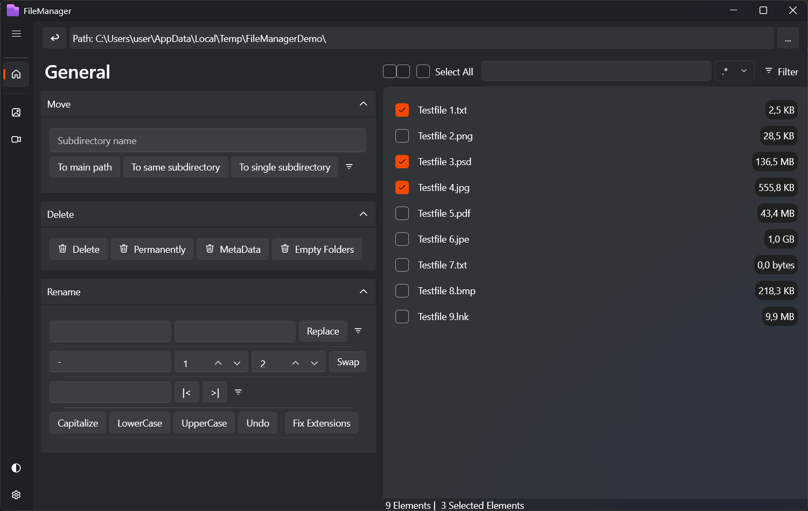

#  FileManager

[](LICENSE)
[](https://dotnet.microsoft.com/download/dotnet/11.0)
[](https://paypal.me/JanEricBe)

A Windows tool for batch editing files: move, rename, delete and clean up many files at once.

I built it for organizing my own files and use it as a playground for WPF and MVVM development.



Built with WPF, .NET 11 and [WPF UI](https://github.com/lepoco/wpfui) (Fluent design with Mica backdrop, light and dark theme).

## Features

- **File list** - List all files in a folder and its subfolders, filtered by search text or extension.
- **Move** - Move files to the main folder, into a shared subfolder or into one subfolder per file.
- **Rename** - Replace text, swap name parts around a separator, add text at the start or end, change the casing and undo the last rename. The part that will be replaced is highlighted.
- **Fix extensions** - Make extensions lowercase and standardize them (for example `.jpeg` and `.jpe` to `.jpg`).
- **Delete** - Move files to the recycle bin, delete them permanently, remove their metadata or delete empty folders.
- **Group similar images** - Find visually similar images and move or delete them.
- **Quick selection** - Select all files, every second file, or select by hovering over the checkboxes.
- **Drag and drop** - Drop a folder onto the path bar or onto `FileManager.exe` to open it.
- **Remembers your settings** - Theme and selected options are saved between sessions.

## Requirements

- Windows 10 version 1809 (build 17763) or later / Windows 11
- [.NET 11 Desktop Runtime](https://dotnet.microsoft.com/download/dotnet/11.0)
- [ExifTool](https://exiftool.org/) (optional, only for removing metadata) - place `exiftool(-k).exe` in an `Extensions` folder next to `FileManager.exe`.

## Installation

> [!WARNING]
> FileManager renames, moves and deletes files in bulk. Back up your files before you try it on anything important.

There is no prebuilt release yet. Build it from source as described below.

## Usage

1. **Open a folder** - Pick a folder with the `...` button or drag a folder onto the path bar.
2. **Select files** - Filter the list by name or extension, then check the files you want to edit.
3. **Edit** - Use the **Move**, **Delete** or **Rename** sections on the left. The status bar shows how many files are selected.

## Building from Source

**Prerequisites:**

- [.NET 11 SDK](https://dotnet.microsoft.com/download/dotnet/11.0)

```bash
git clone https://github.com/Jan-Eric-B/file-manager.git
cd file-manager
dotnet build src/FileManager/FileManager.csproj -c Release
dotnet run --project src/FileManager
```

## Roadmap / Future Plans

- **Installer** - Setup file and automatic download of FFmpeg and ExifTool.
- **Copy names and paths** - Copy the names or paths of the selected files.
- **Image and video tools** - Convert, flip, rotate and grayscale images and videos.
- **Video editing** - Extract frames, cut and merge videos.
- **Metadata view** - Show the metadata of a file.
- **Folder editing** - Apply the same operations to folders.
- **More settings** - A settings window with more configuration options.

## Dependencies

| Library                                                                 | License      | Purpose                           |
| ----------------------------------------------------------------------- | ------------ | --------------------------------- |
| [CommunityToolkit.Mvvm](https://github.com/CommunityToolkit/dotnet)     | MIT          | MVVM architecture                 |
| [ExiftoolWrapper](https://github.com/brain2cpu/ExiftoolWrapper)         | MIT          | Metadata removal through ExifTool |
| [ImageComparison](https://github.com/tomap/ImageComparison)             | CPOL 1.02    | Grouping similar images           |
| [Microsoft.Extensions.Hosting](https://github.com/dotnet/runtime)       | MIT          | Dependency injection & hosting    |
| [Ookii.Dialogs.Wpf](https://github.com/ookii-dialogs/ookii-dialogs-wpf) | BSD-3-Clause | Folder picker                     |
| [WPF UI](https://github.com/lepoco/wpfui)                               | MIT          | Fluent UI controls                |

## License

FileManager is licensed under the **GNU General Public License v3.0**. See [LICENSE](LICENSE) for the full text.

## Disclaimer

FileManager is provided "as is", without warranty of any kind. I am not responsible for any data loss or other damage resulting from the use of this application. **Always back up your files before moving, renaming or deleting them.**
